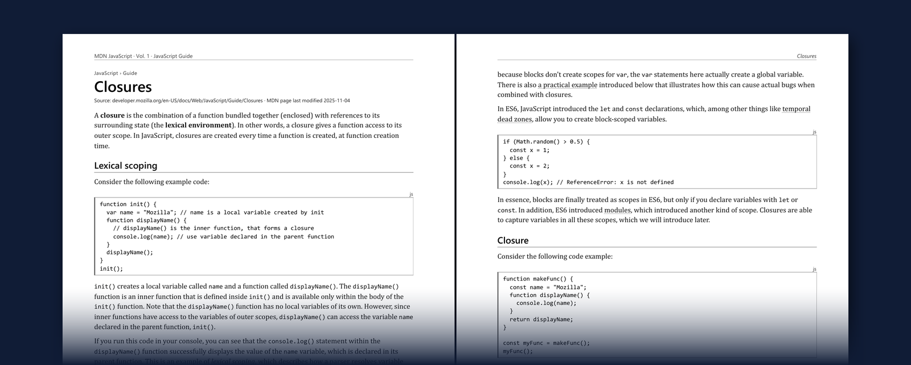

# MDN JavaScript Documentation — Print Edition (unofficial)

The complete English JavaScript documentation from [MDN Web Docs](https://developer.mozilla.org/en-US/docs/Web/JavaScript), laid out as nine print-ready A4 books.

*Volume 1, pages 322–323: the start of* Closures.

**1,346 articles · 3,744 pages · snapshot of 10 November 2026**

Website: <https://sami12344.github.io/mdn-javascript-print-edition/>

**Start here:** [Volume 1, the JavaScript Guide (PDF, 383 pages)](volumes/MDN-JavaScript-Vol01-Guide.pdf) is meant to be read front to back.

> This is an unofficial compilation. It is not published, reviewed or endorsed by Mozilla or MDN.
> The text is by Mozilla Contributors and is licensed CC-BY-SA 2.5 or later — see [Licence and attribution](#licence-and-attribution).

## Why this exists

MDN is the JavaScript reference most developers use every day, but it only exists on a screen. Many people learn better from paper: reading on a screen for hours is tiring, hurts some people's eyes, and makes it hard to stay focused.

This edition lets you study the same material as a physical book. The wording, code and section order are MDN's own, so what you read here is what you will find on the website when you look something up while coding. It contains the whole JavaScript section of MDN — the Guide and the full Reference — not a selection.

## Download

| Vol. | Contents | Articles | Pages | Sheets (double-sided) |
|---|---|---|---|---|
| 1 | [JavaScript Guide](volumes/MDN-JavaScript-Vol01-Guide.pdf) | 38 | 383 | 192 |
| 2 | [Reference: Expressions & operators · Statements & declarations](volumes/MDN-JavaScript-Vol02-Reference-Operators-Statements.pdf) | 114 | 448 | 224 |
| 3 | [Reference: Functions · Classes · Regular expressions · Errors · Misc](volumes/MDN-JavaScript-Vol03-Reference-Functions-Classes-RegExp-Errors-Misc.pdf) | 179 | 427 | 214 |
| 4 | [Built-in objects: AbstractModuleSource – Date](volumes/MDN-JavaScript-Vol04-Builtins-A-to-Date.pdf) | 195 | 497 | 249 |
| 5 | [Built-in objects: decodeURI() – Iterator](volumes/MDN-JavaScript-Vol05-Builtins-decodeURI-to-Iterator.pdf) | 179 | 497 | 249 |
| 6 | [Built-in objects: JSON – Proxy](volumes/MDN-JavaScript-Vol06-Builtins-JSON-to-Proxy.pdf) | 162 | 478 | 239 |
| 7 | [Built-in objects: RangeError – SyntaxError](volumes/MDN-JavaScript-Vol07-Builtins-RangeError-to-SyntaxError.pdf) | 160 | 382 | 191 |
| 8 | [Built-in objects: Temporal](volumes/MDN-JavaScript-Vol08-Builtins-Temporal.pdf) | 242 | 457 | 229 |
| 9 | [Built-in objects: TypedArray – WeakSet](volumes/MDN-JavaScript-Vol09-Builtins-TypedArray-to-WeakSet.pdf) | 77 | 175 | 88 |
| | **Total** | **1,346** | **3,744** | **1,875** |

Also: [Master index](MDN-JavaScript-Master-Index.pdf) — every article in alphabetical order with its volume and page (12 pages).

**Where to start:** Volume 1 is the Guide and is meant to be read front to back. Volumes 2–9 are reference books; print the ones you need.

## What is and is not included

Included: every canonical English article under `developer.mozilla.org/en-US/docs/Web/JavaScript/` on the snapshot date.

- The complete JavaScript Guide, including the intermediate and advanced guides.
- The complete JavaScript Reference: all built-in objects with their constructors, methods and properties; statements and declarations; expressions and operators; functions; classes; regular expression syntax; the error reference; lexical grammar, strict mode, iteration protocols and the other miscellaneous pages.

Not included, because they are separate sections of MDN:

- The *Learn web development* tutorials (the beginner JavaScript course).
- Web APIs such as the DOM, Fetch and Canvas; HTML; CSS; the Glossary.

Links to those pages are kept, and open MDN when you click them in the PDF.

## Is it the same as the MDN website?

The content is the same. The layout is not, on purpose.

**The same, and checked automatically for every article:**

- The article text matches MDN's for all 1,346 articles.
- All 6,857 code blocks (49,890 lines) are character-for-character identical to the source, including indentation.
- Headings, section order, lists, notes, warnings, tables and images are all present.

**Different from the website:**

- **Layout.** Pages are designed for A4 paper, not copied from the site. Navigation, banners and buttons are left out.
- **Interactive examples.** The 589 "Try it" examples and 9 live samples cannot run on paper. Their source code is printed in full; output appears only where MDN's source states it.
- **Browser compatibility tables.** The website builds these from MDN's browser-compat-data. They are rebuilt here from the same data (version 8.1.8) in a compact form: version numbers and words instead of icons, with details as numbered notes.
- **"Baseline" availability.** Shown as one condensed line under the article title; the wording is this edition's, not MDN's.
- **Colour.** There is no syntax highlighting. Red/green "bad"/"good" example colouring is replaced by the labels "✗ bad example" and "✓ good example".
- **Missing characters.** Two rare characters print as empty boxes because no font on the build machine contains them (Vol. 3 p. 121, Vol. 5 p. 202).
- **Date.** This is a snapshot. MDN is edited every day, so the website will drift ahead of the books.

Additions made by this edition (the source line under each title, short notes in dashed boxes) are visibly marked so they cannot be mistaken for MDN's text. The details of every check are in the [verification report](verification/VERIFICATION-REPORT.md).

## Printing

- Paper: A4, double-sided, flipped on the long edge.
- Scale: "Actual size" or 100 %, not "Fit to page".
- Margins are mirrored for binding: 22 mm on the inside edge, 17 mm on the outside. Each volume starts on a right-hand page.
- The pages are black on white with no dark blocks, so a monochrome laser printer is enough.
- Every volume has its own table of contents with printed page numbers, running headers, and PDF bookmarks.
- Typography: body text 11 pt, code 9.25 pt. Browser compatibility tables are smaller (8 pt).

## How it was made

1. **Inventory.** The list of articles was taken from MDN's sitemap and search index (both listed the same 1,346 URLs) and cross-checked by following every in-scope link inside the articles.
2. **Retrieval.** Each article was downloaded from MDN's own rendered page data, where macros and generated content are already resolved. Nothing was rewritten or summarised.
3. **Conversion.** A script removes website-only elements, rewrites links and applies a print stylesheet.
4. **Rendering.** Headless Chrome prints each volume to PDF; a second script adds the contents, bookmarks, running headers and page numbers.
5. **Verification.** A separate script compares the source with the print version and with the text extracted back out of the final PDFs.

About 190 pages of the final PDFs were also looked at by eye for layout faults. The rest are covered by the automated checks only, so an occasional awkward page break is possible. Corrections are welcome.

The scripts are in [`generator/`](generator/), with instructions for rebuilding the collection from the current MDN site. The record of every article — title, URL, retrieval time, content hash, volume and page — is in [`verification/manifest.csv`](verification/manifest.csv).

## Licence and attribution

- **Documentation text and the PDFs.** © Mozilla Contributors, from [MDN Web Docs](https://developer.mozilla.org/en-US/docs/Web/JavaScript), licensed under [CC-BY-SA 2.5](https://creativecommons.org/licenses/by-sa/2.5/) or any later version. The PDFs in this repository are modified copies (re-laid-out for print as described above) and are distributed under the same licence. Each article in the books prints its title and the URL of the MDN page it comes from; the authors of a page are listed on MDN.
- **Code samples.** Samples added to MDN on or after 20 August 2010 are in the public domain ([CC0](https://creativecommons.org/publicdomain/zero/1.0/)); older samples are under the MIT licence.
- **Browser compatibility data.** [`@mdn/browser-compat-data`](https://github.com/mdn/browser-compat-data), CC0.
- **Generator scripts** in `generator/`: MIT licence.

If you share these books, keep the attribution and licence notice with them and share them under the same licence.

"MDN" and "Mozilla" are trademarks of the Mozilla Foundation. They are used here only to say where the content comes from. Mozilla's logos and website design are not part of the licensed content and are not used.

See [LICENSE.md](LICENSE.md) for the full notice.
